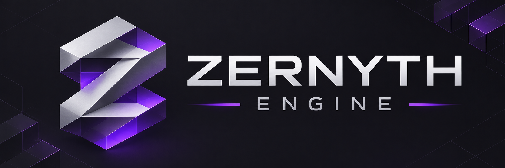
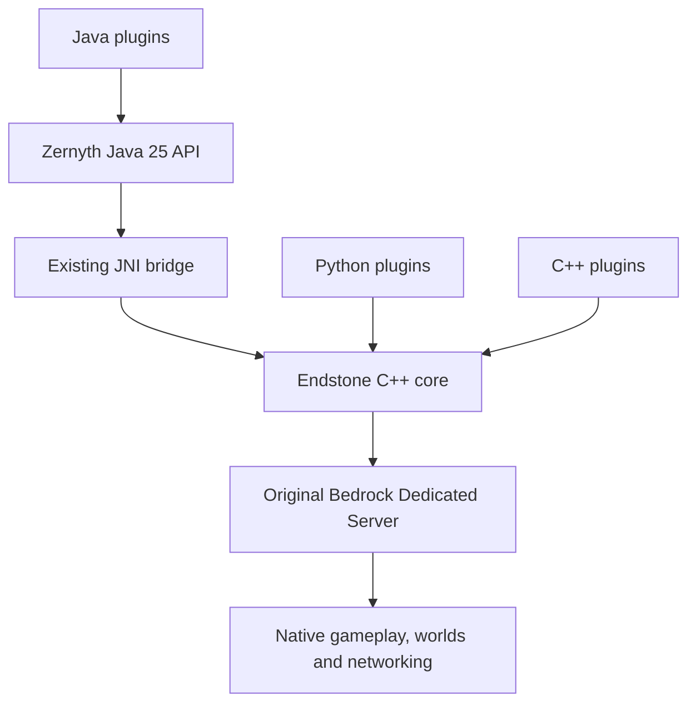

<div align="center">



# Zernyth Engine

### Java-first plugins. Native Bedrock foundations.

A Java 25 plugin framework built into Endstone, powered by the original Minecraft Bedrock Dedicated Server.

[](docs/pypi.md)
[](docs/zernyth-java-25.md)
[](LICENSE)

**[Get started](#-getting-started)** · **[Developer SDK](#-build-your-first-plugin)** · **[Documentation](#-documentation)** · **[Validation](#-validation-and-compatibility)**

</div>

---

> [!IMPORTANT]
> **Alpha 1 — production approval is pending.** Windows builds, native/JNI tests, and local packaging have passed. Real BDS validation of this RC is blocked until network isolation is demonstrated. Windows CI with Temurin 25 has passed. Connected-client gameplay and Linux remain open. See the [complete validation report](docs/validation.md).

## ✦ Built for Bedrock. Designed for Java.

Zernyth Engine brings Java plugin development to the existing Endstone architecture. Write plugins against a public Java API while Endstone handles native integration and the original Bedrock Dedicated Server retains responsibility for worlds, gameplay, protocol processing, and transport.

The framework extends Endstone's **existing plugin manager, event infrastructure, and scheduler**. Java plugins run alongside the existing Python and C++ plugin infrastructure, within one native server process and one embedded JVM.

**Java is the plugin development layer. C++ remains the native integration layer. BDS remains the game engine.**

## 🧩 Framework capabilities

| Area | Implemented functionality |
|---|---|
| **Plugin lifecycle** | JAR discovery, manifests, dependencies, lifecycle callbacks, owner generations, and cleanup |
| **Gameplay** | Player, inventory, item, world, dimension, block, and entity APIs; native Bedrock forms |
| **Events & commands** | Native-backed events, supported synchronous cancellation, typed arguments, subcommands, permissions, and text components |
| **Task execution** | Server-thread tasks, delayed/repeating tasks, bounded asynchronous execution, virtual threads for suitable I/O, and cooperative cancellation |
| **Plugin ecosystem** | Isolated classloaders, local JAR libraries, services, YAML/JSON configuration, and plugin data directories |
| **Networking** | Read-only packet metadata, filtered listeners, priorities, immutable snapshots, and capability checks |
| **Diagnostics** | Plugin profiling, slow-listener diagnostics, task/resource information, and JVM diagnostics |
| **Developer tooling** | Java API artifact, sources, Javadocs, local Maven repository, Gradle/Maven examples, and IntelliJ-oriented template |

Implementation does not imply complete real-server validation. Native mocks and JNI integration tests cover controlled scenarios; individual gameplay paths still require a connected-client BDS test.

## 🏗️ Architecture



- **One JVM per process.** Plugin re-enable uses a new owner generation, plugin instance, and classloader within the existing JVM.
- **Native ownership stays native.** Public APIs do not expose raw C++ pointers; handles and thread affinity are checked by the bridge.
- **The transport stays with BDS.** Packet observations use existing Endstone hooks above the original transport. Zernyth does not introduce a NetherNet, RakNet, or WebRTC stack.
- **Lifecycle cleanup is explicit.** Listener, command, task, service, and form resources follow plugin ownership and generation boundaries.

## 🚀 Getting started

### Requirements

| Component | Requirement |
|---|---|
| **Java** | JDK **25 LTS**, without preview features; Eclipse Temurin preferred |
| **Gradle** | **9.1 or newer**; locally validated with 9.8.2 |
| **Native build** | CMake **3.29+**, Conan 2, Ninja, and the supported platform toolchain |
| **Python** | Compatible build dependencies and an ABI matching the native Python module |
| **BDS baseline** | Separately supplied **1.26.60.6** installation |
| **Endstone basis** | **0.11.15** |

All Java modules use toolchain 25 and `options.release = 25`. Older Java runtimes are unsupported. When Temurin is unavailable, an existing JDK 25 may be selected using the documented `-PzernythJavaVendor=any` override. Local validation used Oracle JDK 25. Windows CI additionally validated Eclipse Temurin 25.0.5.

### Build, verify, install

Python distribution: **`zernyth-engine==0.9.0a1`**, command **`zernyth`**. The first wheel targets Windows x64 / CPython 3.15 and replaces `endstone` in a separate virtual environment. Do not install both packages together. See the [wheel and manual publishing guide](docs/pypi.md); no package upload has been performed in this development phase.

The [Alpha packaging report](docs/pypi-validation.md) records a successful Windows GitHub build with Temurin 25, native/JNI tests, installation and artifact verification. Package uploads use the owner-selected manual target.

1. Follow the **[build and installation guide](docs/zernyth-release-0.9.md)** to prepare the supported toolchain and existing dependency caches.
2. Build Java and native artifacts as a matching versioned set. The shared version comes from [`zernyth-version.txt`](zernyth-version.txt).
3. Run the automated checks and create the local distribution using the documented release driver.
4. Verify the archive and install into a separate versioned directory. Follow the guide for manual updates and rollback.

The documented offline workflow does not automatically download missing JDKs or dependencies. BDS and the JDK are **not bundled**.

> [!NOTE]
> `pip install endstone` installs upstream Endstone, not this Zernyth fork. Zernyth requires this fork's matching native components, Java API, and runtime artifacts.

> [!WARNING]
> Use a separate test instance, a new world, and demonstrable network isolation before BDS testing. Loopback signaling alone does not establish isolation. Archive verification and the default inspection-only launcher do not start a server.

## ☕ Build your first plugin

Start with the **[plugin development template](zernyth-plugin-template/README.md)** or the **[HelloZernyth example](java/example/README.md)**. Open the template in IntelliJ IDEA and select an installed JDK 25.

```java
package dev.example;

import dev.zernyth.api.plugin.JavaPlugin;

public final class ExamplePlugin extends JavaPlugin {
    @Override
    public void onEnable() {
        getLogger().info("Hello from Zernyth Engine!");
    }

    @Override
    public void onDisable() {
        getLogger().info("Plugin resources are shutting down.");
    }
}
```

`src/main/resources/plugin.yml`:

```yaml
name: example_plugin
version: 1.0.0
main: dev.example.ExamplePlugin
```

Use the locally generated SDK repository and declare the API as a compile-time dependency:

```kotlin
repositories {
    maven { url = uri("../java/build/sdk-repository") }
}

dependencies {
    compileOnly("dev.zernyth:api:0.9.0-alpha.1")
}
```

The relative repository path above matches the template directory in this source tree; adapt it for other locations. The template includes the Java 25 toolchain configuration. Maven projects can use the same local artifact with `provided` scope; see the SDK guide and template POM. Do not bundle a second copy of the Zernyth API in a plugin JAR.

**Threading contract:** native gameplay access must obey the documented server-thread restrictions. Run suitable independent Java work asynchronously and schedule native interactions back onto the permitted thread. Cancellation is cooperative; non-cooperative tasks cannot be safely forced to terminate.

## ✅ Validation and compatibility

Current Windows CI results are recorded in the **[Alpha validation report](docs/pypi-validation.md)**. The table also retains earlier local archived-plugin and sanitizer-helper results with their respective scope.

| Validation scope | Status | Evidence boundary |
|---|---|---|
| Java 25 and Windows native/Python build | **PASS** | Oracle JDK 25; Windows x64 |
| Native/JNI suite | **PASS** | **249/249** tests |
| JNI checker | **PASS** | Nine test processes; no reported checker violations |
| Python tooling and CI tests | **PASS** | **46/46** tests |
| Archived example JARs 0.2–0.8 | **PASS** | Lifecycle regression with the production JNI bridge and native mocks |
| Packaging, extracted import, SDK template | **PASS** | Local installation and offline template build |
| Handle-helper ASan/UBSan | **PASS** | Bounded helper only; not the entire core |
| Windows leak detection | **BLOCKED** | Unsupported by the installed ASan runtime |
| Real BDS lifecycle for this RC | **BLOCKED** | Network isolation not demonstrated |
| Connected-client gameplay and packet tests | **NOT TESTED** | Requires an isolated server and compatible Bedrock client |
| Eclipse Temurin 25.0.5 on Windows | **PASS** | Native/JNI tests and isolated wheel installation |
| Linux and full-core sanitizers | **NOT TESTED** | Separate validation remains open |
| CI execution | **PASS** | Manual Windows build-only run, artifact downloaded and verified |

Other BDS versions are not approved by this RC's compatibility contract. A successful mock test, import, or server startup does not establish complete gameplay compatibility. No TPS, player-capacity, or universal compatibility guarantee is made.

<details>
<summary><strong>Scope and security limitations</strong></summary>

- No complete Bukkit/Paper compatibility. The current adapter is a limited porting foundation.
- No generic raw-packet sending, modification, or cancellation in the Java networking contract.
- No native dynamic client tab-completion guarantee.
- Classloader isolation is not a process sandbox. Plugins can still impair the JVM or server process.
- JNI checks and sanitizer passes do not prove complete memory safety.
- Full-core sanitizer, platform, long-running, and real-client quality gates remain open.

</details>

## 📚 Documentation

| Guide | Contents |
|---|---|
| [Build, installation & release](docs/zernyth-release-0.9.md) | Offline builds, distribution layout, verification, updates, rollback, and CI prerequisites |
| [Validation report](docs/validation.md) | Executed tests, artifacts, platform matrix, blockers, and release gates |
| [Java 25 standard](docs/zernyth-java-25.md) | Toolchains, vendor selection, bytecode, JNI, and CMake |
| [Security & reliability](docs/zernyth-security-0.8.md) | Input validation, lifetime rules, and regression testing |
| [Developer API & compatibility](docs/zernyth-developer-0.7.md) | Commands, text components, and porting boundaries |
| [Runtime & profiling](docs/zernyth-runtime-0.6.md) | Async work, cancellation, limits, metrics, and benchmarks |
| [Plugin ecosystem & SDK](docs/zernyth-ecosystem-0.5.md) | Classloaders, services, configuration, libraries, and API artifacts |
| [Networking](docs/zernyth-network-0.4.md) | Read-only packet observations and capability restrictions |
| [Gameplay](docs/zernyth-advanced-0.3.md) | Native-backed inventory, world, entity, and forms APIs |
| [Plugin template](zernyth-plugin-template/README.md) | IntelliJ setup, manifest, Gradle/Maven, and troubleshooting |

Some detailed guides are currently in German. This README provides the English project overview; technical limits in the linked guides continue to apply.

## 🤝 Contributing

Report Zernyth-specific issues in the **[Zernyth repository](https://github.com/MakisImperium/endstone-zernyth/issues)**. Include the engine version, JDK, operating system, reproduction steps, and sanitized logs. Never include credentials, authentication tokens, or unnecessary player data.

Read [CONTRIBUTING.md](CONTRIBUTING.md) before making changes. Extend the existing architecture, preserve Java/Python/C++ compatibility, add reproducible tests for relevant changes, and clearly distinguish mock tests from real BDS validation.

## ⚖️ License and attribution

**Zernyth Engine is distributed under the [Apache License, Version 2.0](LICENSE).**

This project is a fork of **[Endstone](https://github.com/EndstoneMC/endstone)** and includes Endstone code under Apache-2.0. Original copyright, license, and attribution notices are retained. This README has been modified for the Zernyth fork; it does not replace the full license text. Redistribution is subject to the accompanying license, including applicable notice-preservation and modification requirements.

Third-party dependencies may have separate license terms; see [third-party attribution and distribution notes](THIRD_PARTY_NOTICES.md). Minecraft and the Bedrock Dedicated Server are separate from the Apache-licensed Zernyth source and remain subject to their respective owners' terms. Proprietary BDS binaries are not included. The Apache license does not grant rights to third-party trademarks. Software is provided without warranties as set out in the license.

Zernyth is an independent project and is not an official Endstone, Mojang, or Microsoft product. Thank you to the Endstone contributors for the native foundation that makes this framework possible.

---

<div align="center">

<br>
<strong>Zernyth Engine</strong><br>
Java-first extensibility · Native Bedrock foundations · Explicit compatibility
</div>
